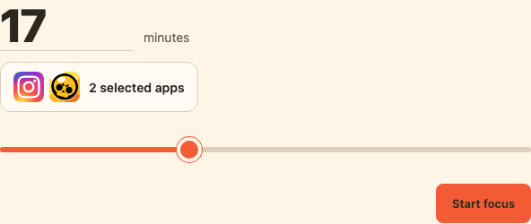

# Automatically selected app icons in chat

Implemented 2026-11-06 on `codex/agent-focus-integration`. The explicitly authorized
development phone identifies the selected application tokens using
`FamilyActivityData`. Only the matched bundle identifiers are shared with the
paired relay. A trusted, bundled catalogue supplies artwork alongside the
draggable session-duration selector. Maximum selection remains separate.

Current catalogue: Instagram and Brawl Stars. Unknown identifiers display a
placeholder; missing permission or missing identifiers retains the selected-app
count. Categories and websites remain separate counts. No manually authored app
association or app groups are required. Catalogue art is not a capture of the
installed alternate, seasonal or tinted icon.

## Transport and consistency

- The main app asynchronously refreshes a local selected-only identity cache.
  It does not block command delivery on this native API request.
- Cache entries match the exact application tokens using a locally computed
  fingerprint. Neither tokens nor fingerprints are sent to the relay. A changed
  selection cannot inherit the previous selection's identities.
- The generic persisted phone boundary reports the effective default selection
  when idle, or the actual active selection during a session.
- Delivery checks fresh explicit data-access approval outside the phone lock,
  after network waits, immediately before snapshot publication. Missing approval
  withholds IDs. Clearing a revoked cache schedules a corrective sync.
- Extension and expiry delivery do not enumerate applications or publish identity
  metadata. They omit IDs, so a new picker opened from such a snapshot can show
  counts until the main app supplies another authorized snapshot.
- The relay accepts at most 50 unique syntactically valid bundle IDs, never more
  than the selected application count. Snapshot bodies are bounded at 32 KiB;
  other endpoints retain their 8 KiB limit. No image URLs or tokens are accepted.
- Session draft polling adopts current catalogue labels/artwork, clears missing
  identities and preserves duration. Submitted requests remain immutable.
  Opening, refreshing and editing never queue a blocking command.
- PNGs are embedded as data URLs; rendering does not contact an external icon
  service. Resource HTML carries the full image license and provenance notices.

## Source and deployment scope

See [artwork provenance](../../../experiments/agent-focus/src/ui/icons/README.md)
for sources, licenses, ownership and limitations. Apple Search API artwork is not
used. This is the existing personal development experiment; the gated data API
is not presented as a Taiwan customer-distribution solution or as production
artwork rights clearance.

## Validation and activation

- TDD RED/GREEN: selected-only delivery payload, permission revocation during a
  network wait, strict relay identities, long valid identity payloads, MCP draft
  changes and DOM rendering/fallbacks. Existing public test seams only.
- 87 Swift tests and 99 Node tests pass. Swift-format lint passes changed files.
- Signed Xcode 27.2 Debug build and SDK/profile preflight pass; unsigned Release
  build passes. Both normal and data-access compilation paths compile.
- Real isolated browser/AppBridge check decodes both PNGs, removes stale icons,
  displays an unknown-app fallback, preserves a 17-minute draft, keeps maximum
  controls separate, and detects no external requests or page errors. The image
  above is from this fixture, not a live phone command.
- Live relay database backed up before activation. Updated relay restarted;
  signed app installed over the paired iPhone 13 and launched normally.
- Fresh live snapshot confirmed `com.burbn.instagram` and `com.supercell.laser`,
  two selected apps, no active session and unchanged 45-minute maximum.
- Final live **chat rendering** awaits a Codex restart to reload the MCP module
  handlers. This verification must not be replaced by the isolated browser proof.

Local evidence: `/tmp/docard-chat-icons-{swift,node,browser,phone-build,release}.log`.
